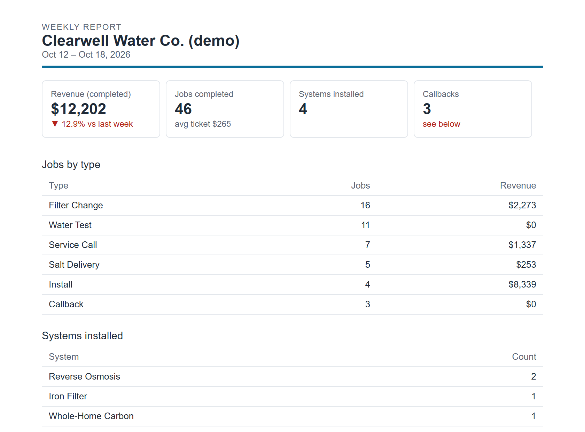
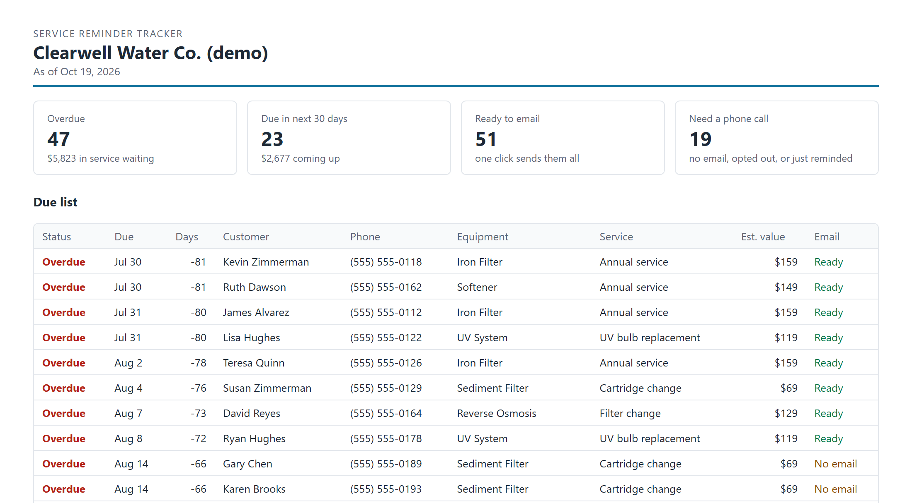
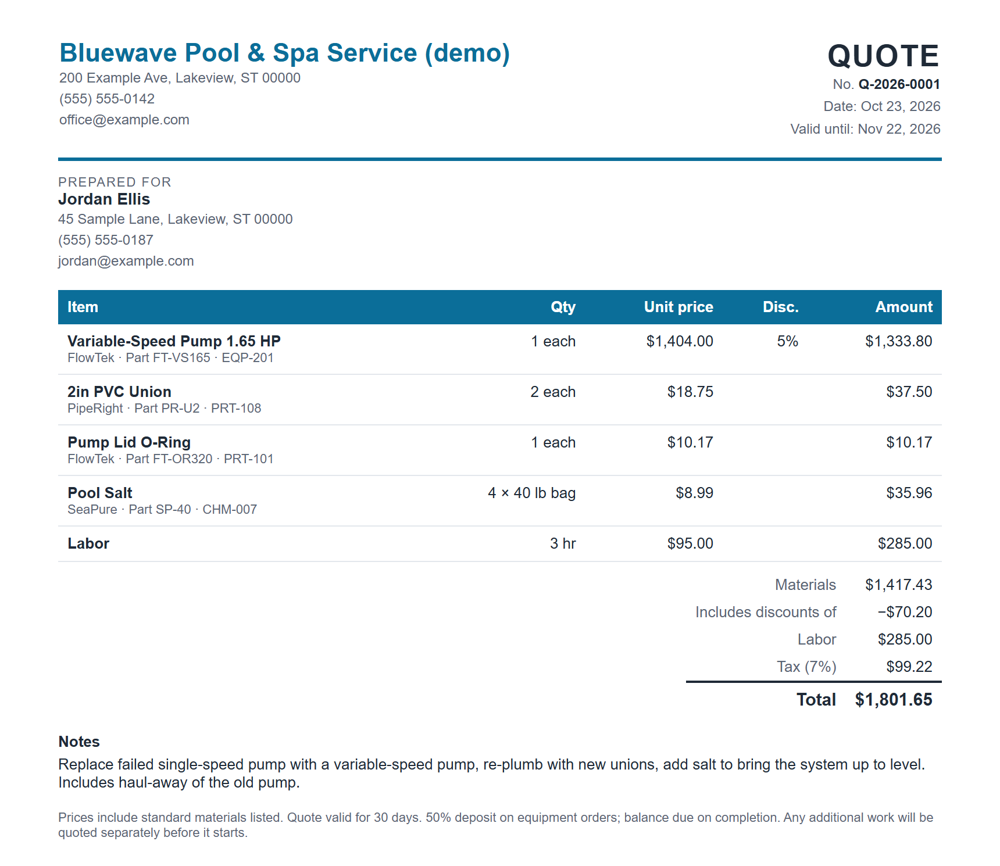
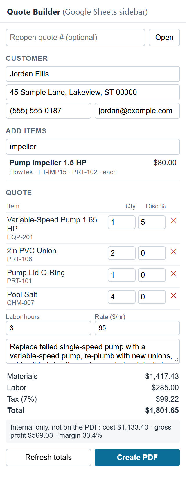
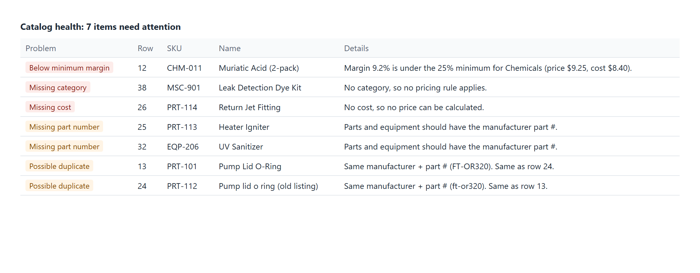
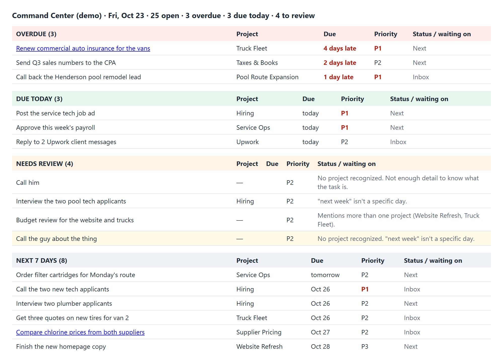
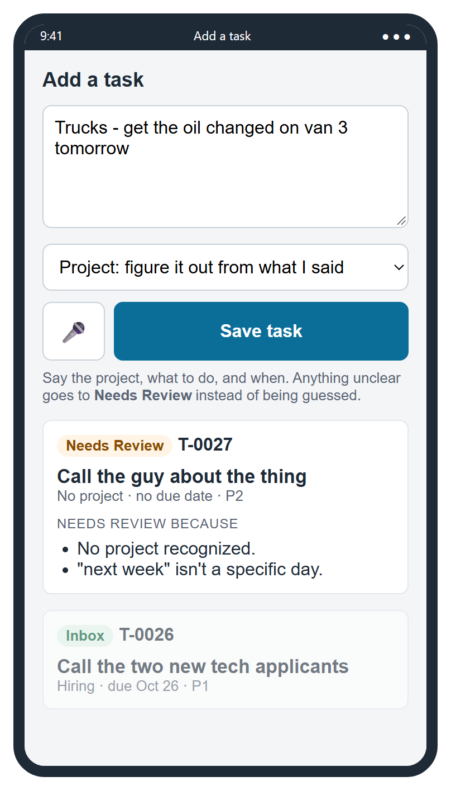
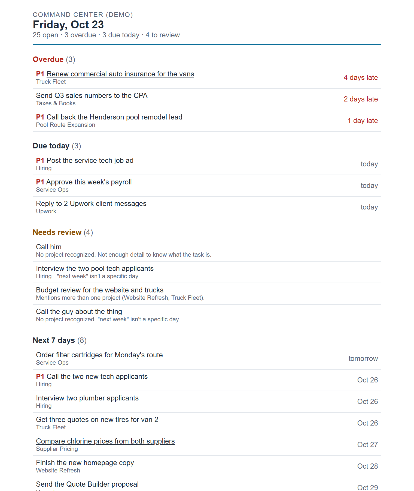

# Field-Service Sheets Automation

Google Sheets + Apps Script tools for small service businesses: the kind of back-office
automation an owner wishes they had, running entirely inside their own Google account.
No new software subscriptions and no outside servers.

Built by an owner-operator of a residential water-treatment service company, from the problems
we actually deal with: Monday numbers, who's due for service, quoting parts and labor, and
keeping track of everything we said we'd do.

**Every company, customer, product and number in this repo is made up.**

| Tool | What it does |
|---|---|
| [Weekly KPI Report](#1-weekly-kpi-report) | Emails the owner a one-page report every Monday: revenue, jobs by type, callbacks with cause and tech, quote close rate, tech leaderboard |
| [Service Reminder Tracker](#2-service-reminder-tracker) | Finds customers due for filter changes and maintenance, shows the $ waiting, and sends personalized reminders after a preview and one confirmation |
| [Quote Builder](#3-quote-builder) | Parts catalog with markup/margin rules, catalog health checks, a Sheets sidebar for building quotes, and branded PDF quotes filed in Drive |
| [Command Center](#4-command-center) | One master task list for several businesses: capture tasks by voice from your phone, flag emails into tasks, Today/Overdue/Waiting views, and a morning digest |

---

## 1. Weekly KPI Report



Reads `Jobs` and `Quotes` tabs (pasted from Jobber or any CRM export) and emails a report every
Monday at 7am. Bad rows (unreadable amounts, missing dates) are listed as "data problems to fix"
instead of being silently dropped.

Code: `apps-script/ReportCore.js` (math + HTML), `apps-script/weekly-report/Main.js` (menu, email, trigger)

## 2. Service Reminder Tracker



Owner-set intervals and prices per equipment/service. Builds a daily Due List, tells you who can be
emailed vs. who needs a call (no email, opted out, reminded recently), previews every email, asks
for confirmation before sending, and records when each customer was reminded so nobody gets a duplicate.

Code: `apps-script/reminders/`

## 3. Quote Builder



| Sidebar | Catalog health |
|---|---|
|  |  |

Prices update automatically when costs change. Margin is shown to the office, never on the
customer's PDF. Quotes are numbered, logged, and can be reopened and revised (`Q-2026-0001-R1`).

Code: `apps-script/quotes/`

## 4. Command Center



| Phone capture | Morning digest |
|---|---|
|  |  |

One master task list across several businesses, in Google Sheets.

- **Capture from your phone by voice or text** (an Apps Script web app on your home screen):
  *"Hiring. Post the tech job ad by Friday, urgent"* → project, due date and priority filled in.
- **Anything unclear goes to Needs Review with the reason** (no project, "next week", two dates, a date
  in the past, too little detail) instead of being guessed. "1/2 inch" is never read as a date.
- **Flag an email** with a "To Task" label → it becomes a task linked back to the thread.
- **Views:** Overdue, Due today, Needs review, Next 7 days, P1, Waiting on others, plus a **7am digest email**.
- Never sends email to anyone but you, never deletes tasks, and logs every automation run.

Code: `apps-script/commands/`

---

## How it's built

- **Pure logic is separate from Google.** `*Core.js` files contain all math, parsing and HTML, and use
  no Apps Script APIs, so the same code runs in Google and in the browser tests.
- **Money is integer cents** everywhere. No floating-point drift.
- **Tested:** open `tests/test.html` through a local server to run the browser test suite.
- **Fake data generators** in `tools/` (Python, standard library only).

## Try it locally

```bash
python -m http.server 8765
```

Then open:
- `http://localhost:8765/tests/test.html` to run the tests
- `http://localhost:8765/demo/preview.html` for the weekly report
- `http://localhost:8765/demo/reminders.html` for the reminder tracker
- `http://localhost:8765/demo/quotes.html?sample` for the quote builder with the real sidebar UI
- `http://localhost:8765/demo/commands.html?sample` for the command center

## Put one in Google Sheets

1. Create a Google Sheet and open **Extensions → Apps Script**.
2. Add the files from the tool's folder plus `apps-script/ReportCore.js` (and its `*Core.js`).
3. Create the tabs the tool expects (listed at the top of its main `.js` file) and paste in your data,
   or the matching CSVs from `demo/sample-data/`.
4. Reload the sheet and use the new menu. Google will ask you to authorize the script the first time.
